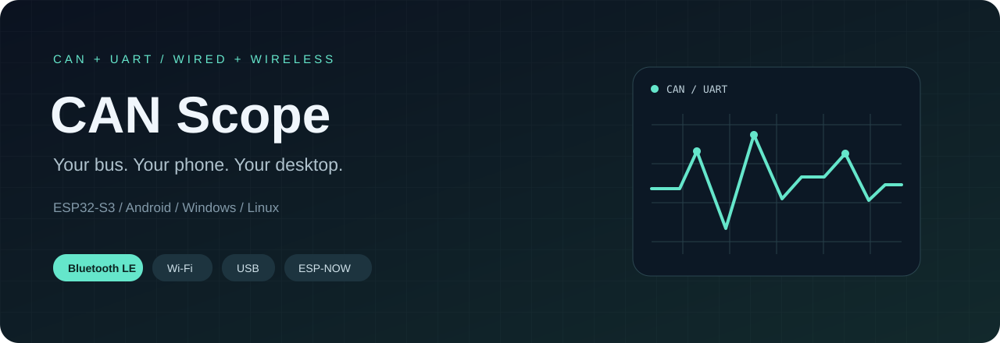
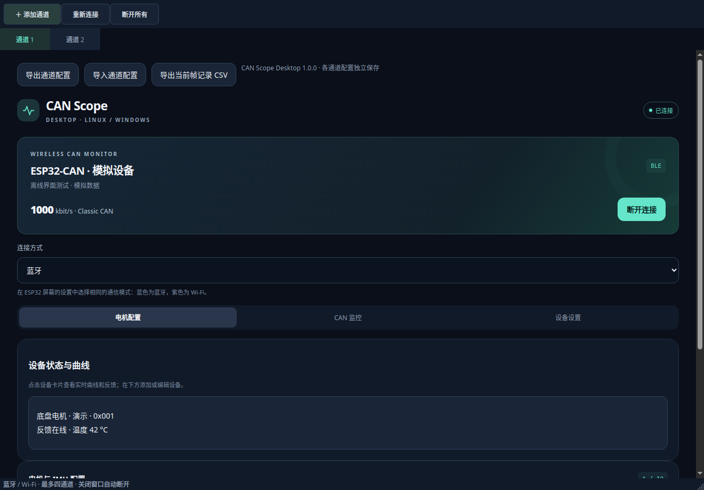
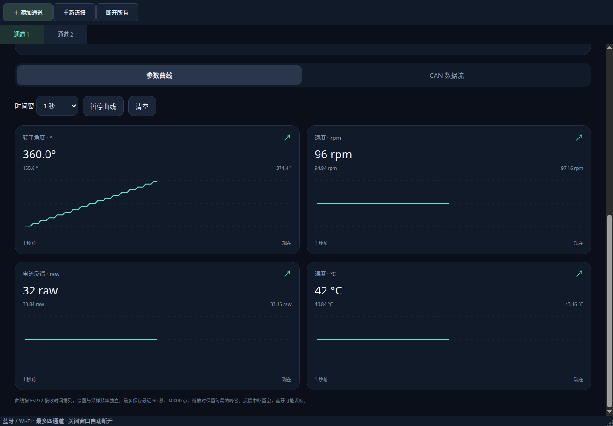
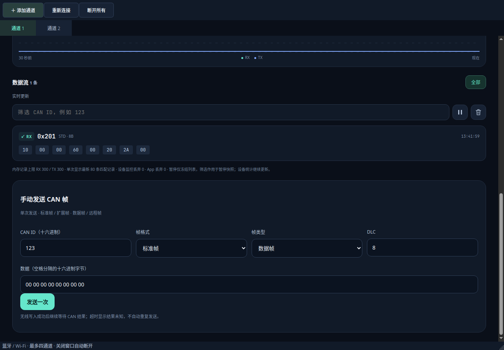
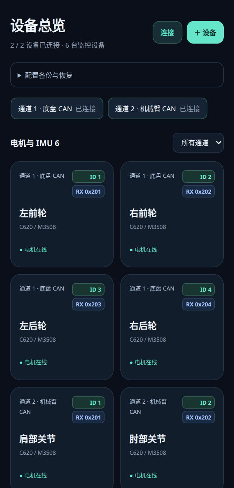
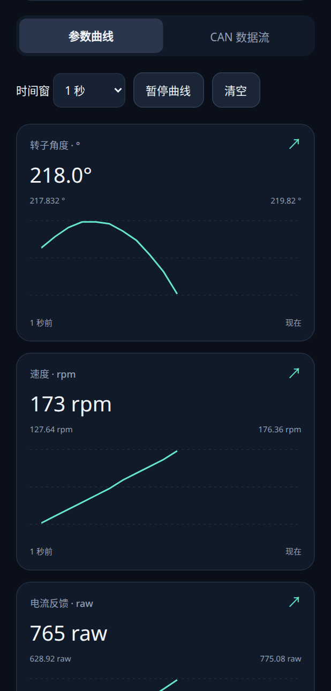
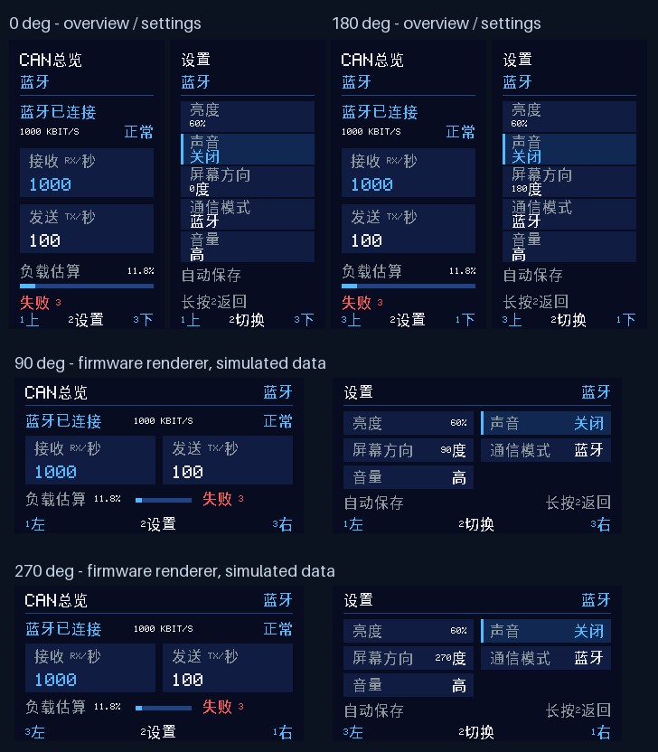

<p align="center">
  
</p>

<h1 align="center">Wireless CAN Analyzer</h1>

<p align="center">
  <strong>CAN Scope · 在手机和电脑上，看懂你的 CAN 与 UART 数据。</strong><br>
  ESP32-S3 固件 · Android App · Windows / Linux 桌面端 · 本机屏幕
</p>

<p align="center">
  <a href="#hardware"></a>
  <a href="#quickstart"></a>
  <a href="docs/DUAL_CAN.md"></a>
  <a href="LICENSE"></a>
</p>

<p align="center">
  <a href="#preview">界面预览</a> ·
  <a href="#features">功能特性</a> ·
  <a href="#download"><strong>下载与运行</strong></a> ·
  <a href="#quickstart">快速上手</a> ·
  <a href="#hardware">硬件接线</a> ·
  <a href="#build">源码构建</a> ·
  <a href="#docs">文档导航</a>
</p>

**CAN Scope** 是面向机器人与嵌入式调试的 CAN / UART 工具，提供 ESP32-S3 固件、Android App 和 Windows / Linux 桌面端完整源码。通过蓝牙、局域网或 USB 查看原始报文、电机与 IMU 状态、实时曲线，也能把外部单片机的 UART 字节流带到手机和电脑上。

设备带有独立屏幕和按键，可查看状态、切换通信方式及保存设置。两台设备还能通过 ESP-NOW 组成无线桥，在不连接 App 的情况下转发两端的 CAN 或 UART 数据。

<sub>ESP32-S3 CAN &amp; UART analyzer with Android, Windows and Linux clients. Live telemetry, motor and IMU decoding, BLE / Wi-Fi / USB connectivity, and standalone ESP-NOW bridging.</sub>

<a id="preview"></a>

## 界面预览

### 桌面端：多通道监控与实时曲线



<details>
<summary>查看电机曲线与 CAN 报文界面</summary>





</details>

### Android：设备总览与独立详情

<table>
  <tr>
    <td align="center" width="50%"><strong>多通道设备总览</strong></td>
    <td align="center" width="50%"><strong>参数与实时曲线</strong></td>
  </tr>
  <tr>
    <td align="center"></td>
    <td align="center"></td>
  </tr>
</table>

<details>
<summary>查看设备屏幕与按键界面</summary>

<p align="center">
  
</p>

中文总览与设置页支持四方向布局、亮度、声音、通信模式和 CAN / UART 选择，设置断电保存。本机屏幕显示状态和统计，原始报文在 App 或桌面端查看。

</details>

<sub>桌面图为 Linux 程序实际渲染；Android 图为 App WebView 页面在浏览器中的渲染；屏幕图由固件实际绘制代码生成。均使用模拟数据，不代表手机、屏幕或真实总线的实测结果。</sub>

<a id="features"></a>

## 功能特性

| 能力 | 你可以做什么 |
| --- | --- |
| **多通道监控** | Android 管理多个设备；桌面端提供最多四个独立通道，每个通道保存自己的连接、设备和记录配置 |
| **CAN 报文分析** | 查看 RX / TX、CAN ID 筛选、发送失败原因、设备端帧率及估算总线负载；桌面端支持经典 CAN 单次发送 |
| **电机与 IMU 解码** | 查看大疆、达妙电机反馈与温度，解析达妙 IMU 的加速度、角速度、姿态角和四元数 |
| **实时曲线** | 独立设备详情、全屏曲线与采样设置；达妙电机可按设备开启 1～1000 Hz 反馈查询，默认 100 Hz |
| **UART 字节收发** | HEX / UTF-8 显示与发送、换行追加、暂停和清空；支持八档波特率，默认 115200 / 8N1 |
| **配置与记录** | 通道及设备配置导入 / 导出、成功连接记录与重连；桌面端可导出当前保留的 CAN 记录为 CSV |
| **本机操作** | ST7789 中文屏幕、三个按键、四方向布局、PWM 背光、四档声音和通信指示灯 |
| **远程设置** | 通过现有连接查询或保存通信模式、CAN / UART 选择和串口波特率；原生 USB 支持无需按键切入 USB 模式 |

### 选择适合你的连接方式

| 方式 | Android | Windows / Linux | 适合场景 |
| --- | :---: | :---: | --- |
| **Bluetooth LE** | ✓ | ✓ | 近距离无线调试，按通道连接设备 |
| **Wi-Fi 局域网** | ✓ | ✓ | 设备与上位机处于同一局域网，通过认证蓝牙取得信任信息后使用 TLS 连接 |
| **原生 USB** | — | ✓ | 电脑直连，无需配网；同一个接口承载 CAN 或 UART |
| **ESP-NOW 双机** | 无需 App | 无需上位机 | 两台设备组成 A / B 无线桥，转发两端 CAN 或 UART 数据 |

每台设备同时只使用一种数据通信模式，并在 CAN / UART 中选择一种数据类型。双机模式下，两端须选择相同数据类型；CAN 转发连接的是两条独立总线。

### 已接入的协议

| 类别 | 型号 / 协议 | 说明 |
| --- | --- | --- |
| 大疆电机 | C620 / M3508、C610 / M2006、GM6020、GM3510 | 按型号解析反馈；GM3510 部分参数保留原始值 |
| 达妙电机 | DM4310 等型号预设、自定义解码范围 | 独立 ID / Master ID 配置，支持反馈查询 |
| 达妙 IMU | DM-IMU-L1 | 解析主动 CAN 上报的惯性与姿态数据 |

完整型号、量程及协议来源见 [电机型号表](docs/MOTOR_CATALOG.md)、[电机协议](docs/MOTOR_PROTOCOLS.md) 和 [DM-IMU-L1](docs/DM_IMU_L1.md)。

<a id="download"></a>

## 下载与运行

### 使用发行包

**[下载最新完整套件 →](https://github.com/QianmoNai/Wireless-CAN-Analyzer/releases/tag/suite-2026.11.05)** · [Gitee 国内下载](https://gitee.com/qianmonai/Wireless-CAN-Analyzer/releases/suite-2026.11.05)

本次完整套件包含固件 **1.24.2**、Android **1.21.0** 和 Desktop **1.2.4**（Windows / Linux x64）。各组件独立编号，下载后按 Release 中的 SHA256SUMS 校验。

Android 需 Android 8.0+；Windows 支持 Windows 10 / 11 x64；Linux 桌面包以 Ubuntu 24.04 构建。桌面包完整解压后运行 `CAN-Scope` / `CAN-Scope.exe`，无需另装 Python。固件适用于本项目 ESP32-S3 / 4 MB Flash，按包内 README.txt 烧录。

仓库公开。Android APK 使用开发签名，Windows 程序未代码签名；若签名不同需要卸载旧版，请先导出配置。构建与自动测试通过不代表已完成全部实机兼容性、距离或持续吞吐验证，详见发行说明。

### 使用当前源码

| 组件 | 源码版本 | 入口 |
| --- | --- | --- |
| ESP32-S3 固件 | **1.24.6** | [构建与烧录](#build) |
| Android App | **1.21.5** | [Android 构建](#build-android) |
| CAN Scope Desktop | **1.2.16** | [桌面使用说明](desktop/README.md) |

这些源码版本尚未包含在上方完整发行套件中。新增 CAN 批量接收、首页摘要和曲线开销优化；Android 修复局域网发现重试、TLS 断开闪退及返回操作；桌面修复 USB 取消清理竞态；固件增加物理 USB 自主配对并修复双机队列误判过期。具体实机条件、有效结果与未通过的候选见 [性能与验证记录](docs/PERFORMANCE.md)。双路模拟器源码见 [STM32H723 台架](fixtures/stm32-h723/README.md)。

```bash
git clone git@github.com:QianmoNai/Wireless-CAN-Analyzer.git
cd Wireless-CAN-Analyzer
```

桌面源码运行需要 **Python 3.12（64 位，推荐）**：

- **Linux**：在仓库根目录执行 `bash desktop/start.sh`。
- **Windows**：安装 Python 并加入 PATH，双击 `desktop/start.bat`。

启动脚本首次创建独立虚拟环境并安装依赖。Linux 的图形运行库、蓝牙及串口权限配置见 [桌面版文档](desktop/README.md#从源码运行)。桌面 CI 的安装包保存在对应运行的 **Release 草稿**，不是新的正式完整套件。

<a id="quickstart"></a>

## 快速上手

1. **准备设备**：使用 ESP32-S3、SN65HVD230 与配套固件；连接 CANH / CANL、共地，并按总线两端配置终端电阻。
2. **启动客户端**：安装 Android App，或在 Windows / Linux 运行桌面端。使用新功能时同步更新对应客户端与固件。
3. **建立连接**：在设备屏幕选择通信模式，在客户端选择对应入口；首次使用可从蓝牙或桌面 USB 开始，具体步骤见下表。
4. **选择数据**：CAN 模式下设置与总线一致的波特率，添加电机或 IMU 及其反馈 ID；UART 模式下按 3.3 V TTL 交叉接 TX / RX，选择相同串口速率。
5. **查看与记录**：打开设备详情查看曲线，或查看原始 CAN / UART 数据；达妙电机按需开启反馈查询，IMU 使用主动上报。

```text
电机 / IMU ── CAN 收发器 ─┐                ┌── BLE ───── Android / Desktop
                         ├── ESP32-S3 ────┼── Wi-Fi ─── Android / Desktop
外部 MCU ── 3.3 V UART ───┘       │        └── USB ───── Desktop
                            屏幕 + 按键
```

| 我想… | 下一步 |
| --- | --- |
| 通过蓝牙连接 | 设备选蓝牙模式，客户端扫描并连接；一台设备同时只连接一个上位机 |
| 通过局域网连接 | 先通过认证蓝牙配置 2.4 GHz Wi-Fi 并保存信任信息，再切换设备和客户端模式；见 [Wi-Fi 指南](docs/WIFI.md) |
| 用 USB 连接电脑 | 设备选 USB 直连，插入连接 GPIO19 / 20 的原生 USB 口，桌面端扫描串口；见 [USB 指南](docs/USB.md) |
| 收发单片机串口数据 | 设备选 UART，与外部单片机交叉接线并共地；见 [UART 指南](docs/UART.md) |
| 不用上位机做双机转发 | 两端在屏幕选择 A / B 并核对配对码；见 [双机转发](docs/DUAL_CAN.md) |

<a id="hardware"></a>

## 硬件接线

目标硬件：**ESP32-S3 Mini + SN65HVD230 + 1.47 英寸 ST7789（172 × 320）**，配三个按键和 3 V 有源蜂鸣器。CAN 默认 **1 Mbit/s**。

| 功能 | ESP32-S3 GPIO | 连接 |
| --- | --- | --- |
| CAN TX / RX | **4 / 5** | SN65HVD230 CTX / CRX；模块使用 3.3 V |
| 外部 UART TX / RX | **43 / 44** | 接外部单片机 RX / TX，3.3 V TTL，共地 |
| 原生 USB D− / D+ | **19 / 20** | 原生 USB 接口；与 GPIO43 / 44 的 UART 独立 |
| BT1 / BT2 / BT3 | **1 / 2 / 7** | 按键另一端接 GND，内部上拉 |
| 通信绿灯 | **3** | 经 1 kΩ 接 LED 阳极，阴极接 GND；GPIO3 经 10 kΩ 下拉 |
| 背光 PWM | **6** | 背光 MOSFET 栅极 |
| LCD RESET / D-C / CS | **8 / 9 / 10** | 屏幕复位、命令、片选 |
| LCD MOSI / SCLK | **11 / 12** | SPI 数据与时钟 |
| 有源蜂鸣器 | **13** | 蜂鸣器 MOSFET 栅极 |

CAN 端口按 **CANH / CANL 信号名**接线：当前设计中 CN6 的 1 / 2 脚是 CANH / CANL，CN5 的顺序相反。供电、屏幕适配及完整接线见 [硬件文档](hardware/README.md) 和 [本机面板](docs/LOCAL_PANEL.md)。原理图与 PCB 原始工程尚未纳入仓库。

<a id="build"></a>

## 从源码构建

以下命令均在仓库根目录执行。桌面源码运行见 [下载与运行](#download)，独立打包见 [桌面打包说明](desktop/README.md#打包)。

<details>
<summary><strong>ESP32-S3 固件 · ESP-IDF v6.0.2</strong></summary>

先安装并激活 ESP-IDF，然后执行；将环境与串口路径换成实际值：

```bash
source /path/to/esp-idf/export.sh
bash firmware/idf.sh build
bash firmware/idf.sh -p /dev/ttyACM0 -b 115200 flash
bash firmware/idf.sh -p /dev/ttyACM0 monitor
```

- 目标为 ESP32-S3、4 MB Flash，不需要 PSRAM。屏幕偏移、色序等通过 `bash firmware/idf.sh menuconfig` 调整。
- 默认构建缓存为 `${XDG_CACHE_HOME:-$HOME/.cache}/can-scope-firmware/<项目路径哈希>/esp32s3`；路径含非 ASCII 字符时回退到 `/tmp/can-scope-$UID`。可用 `CAN_IDF_BUILD_DIR` 指定纯英文路径，同一构建目录禁止并发运行。
- 首次迁移保留旧 `firmware/build/esp32s3.sdkconfig`。升级默认不全片擦除，保留 NVS；从旧分区布局升级时需烧录对应分区表，见 [Wi-Fi 构建与升级](docs/WIFI.md#构建与升级)。
- 默认关闭应用、NimBLE、Bootloader 日志及应用控制台，芯片 ROM 启动信息仍可能输出。旧 sdkconfig 不会自动应用新默认值，需要在 `menuconfig` 检查日志与控制台设置，或使用新构建目录。
- VS Code 直接打开 `firmware` 时不会经过 `idf.sh`。项目真实路径含中文时，把 `idf.buildPath` 和 clangd 的 `--compile-commands-dir` 指向同一个纯英文绝对路径；符号链接解析后的路径也需满足此条件。
- 旧 ESP32 兼容路径：`CAN_IDF_TARGET=esp32 bash firmware/idf.sh build`，使用 GPIO21 / 22，默认不启用本机屏幕；主要开发与验证目标为 ESP32-S3。

</details>

<a id="build-android"></a>

<details>
<summary><strong>Android App · JDK 17 + Android SDK 35</strong></summary>

需要 JDK 17、Android SDK Platform 35、Build Tools 35.0.0 和 Python 3；构建脚本不依赖 Gradle。

```bash
export ANDROID_HOME="$HOME/Android/Sdk"
bash android/build.sh
```

产物为 `android/dist/CAN-Scope-debug.apk`。脚本在本机生成开发签名，密钥不随源码分发。默认缓存为 `${XDG_CACHE_HOME:-$HOME/.cache}/can-scope-android/<项目路径哈希>`，可用 `CAN_ANDROID_BUILD_DIR` 指定；每次构建清理旧 class / dex，APK 签名验证通过后才替换产物。

</details>

<a id="docs"></a>

## 文档导航

| 主题 | 文档 |
| --- | --- |
| 桌面安装、连接与打包 | [Desktop](desktop/README.md) |
| 蓝牙配网与局域网通信 | [Wi-Fi](docs/WIFI.md) · [Linux 终端配网](docs/WIFI_PROVISION.md) |
| USB 与远程设置 | [USB](docs/USB.md) |
| 外部单片机串口接线与数据收发 | [UART](docs/UART.md) |
| 无上位机双机转发 | [ESP-NOW A / B](docs/DUAL_CAN.md) |
| 硬件、屏幕与指示灯 | [接线](hardware/README.md) · [本机面板](docs/LOCAL_PANEL.md) · [状态灯](docs/STATUS_LED.md) |
| 数据包、订阅与设置字段 | [通信协议](docs/PROTOCOL.md) |
| 电机与 IMU | [电机协议](docs/MOTOR_PROTOCOLS.md) · [型号目录](docs/MOTOR_CATALOG.md) · [DM-IMU-L1](docs/DM_IMU_L1.md) |
| 测试、性能与实测边界 | [测试指南](tests/README.md) · [性能说明](docs/PERFORMANCE.md) · [发布验证](docs/VALIDATION.md) |
| 依赖与发行 | [依赖来源](docs/DEPENDENCIES.md) · [Release 交付要求](docs/RELEASING.md) |

## 使用范围

- **经典 CAN**：支持标准帧、扩展帧、数据帧与远程帧，不支持 CAN FD；接口正常参与 ACK，并非纯监听模式。
- **监控与查询**：提供状态监测、反馈查询和桌面端单次发帧；App 不提供电机运动控制界面。本机按键不会触发电机运动控制。
- **吞吐与记录**：查询频率和 UART 波特率是配置值，不代表端到端吞吐；高负载可能丢帧 / 丢字节，界面与 CSV 仅保留有界记录。
- **估算负载**：`LOAD EST.` 不包含位填充、错误帧或失败尝试，不能作为精确物理占用率。
- **双机桥接**：转发数据帧 / 字节，不能延伸 CAN 逐位仲裁或 ACK 时序；无线吞吐和距离需在实际环境验证。
- **验证范围**：主机模拟、界面预览、构建与打包检查分别验证对应的软件行为；真实 BLE / Wi-Fi / USB、屏幕及电机联调结果以相应文档和发布说明为准。

## 开发与反馈

按 [测试指南](tests/README.md) 安装 C 编译器、OpenSSL 开发库、Python 依赖、Node.js、Playwright 浏览器和 JDK 17，再运行：

```bash
PATH="$PWD/desktop/.venv/bin:$PATH" bash scripts/test-host.sh
desktop/.venv/bin/python -m unittest discover -s desktop/tests -v
```

以上假设已用桌面启动脚本建立 `desktop/.venv`；仅运行主机测试也可按测试指南使用独立虚拟环境。测试使用驱动桩、模拟数据或本机回环服务器，不连接真实 CAN / BLE 硬件。

欢迎通过 [Issues](https://github.com/QianmoNai/Wireless-CAN-Analyzer/issues) 提交问题或建议，或通过 [Pull requests](https://github.com/QianmoNai/Wireless-CAN-Analyzer/pulls) 改进代码与文档。反馈时请附上固件 / 客户端版本、操作系统、连接方式、设备型号、CAN / UART 速率及复现步骤，并移除日志中的密码和连接凭据。

## 许可证

[GNU GPL v3.0](LICENSE) · `GPL-3.0-only` · Copyright © 2026 QianmoNai。

嵌入的中文点阵字形子集采用 [SIL OFL 1.1](firmware/fonts/OFL-SourceHanSans.txt)，来源与生成方法见 [字库说明](firmware/fonts/README.md)。外部依赖与协议资料遵守各自许可。本项目不隶属于大疆、达妙或乐鑫，品牌与型号仅用于说明兼容设备。

---

<p align="center">
  <a href="https://github.com/QianmoNai/Wireless-CAN-Analyzer">GitHub</a> ·
  <a href="https://gitee.com/qianmonai/Wireless-CAN-Analyzer">Gitee</a> ·
  <a href="https://github.com/QianmoNai/Wireless-CAN-Analyzer/releases">Releases</a>
</p>
