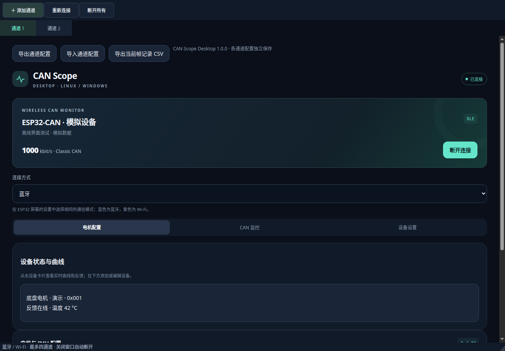
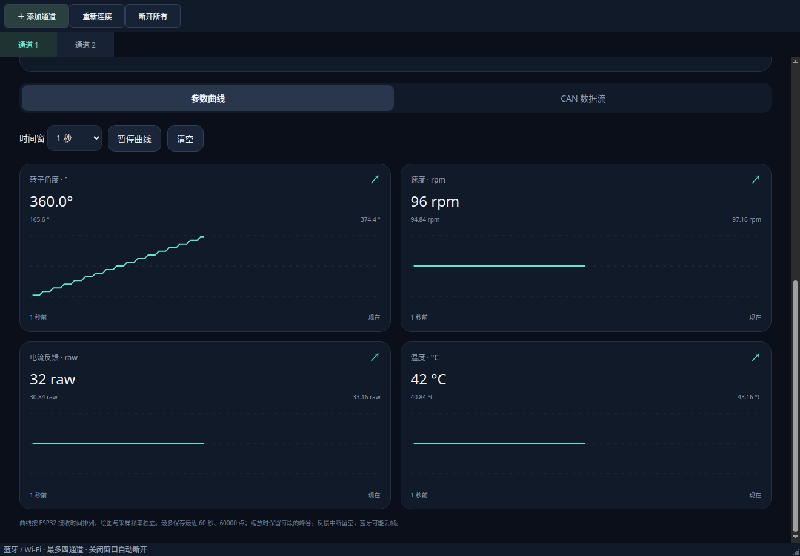
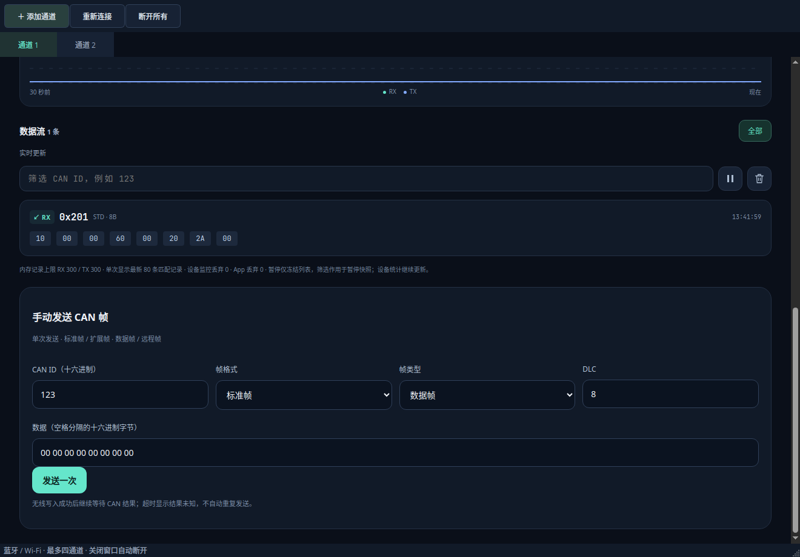

# CAN Scope Desktop 1.0.0

Linux / Windows 桌面上位机，连接本项目 ESP32-S3 固件。Qt 桌面窗口复用 Android 的电机解析、曲线、配置与监控资源，BLE 使用系统 BlueZ / WinRT，局域网使用证书指纹绑定的 TLS 1.2。设备双机 A/B 模式不接受上位机连接。

## 功能

- 最多四个独立通道，每通道可选蓝牙或 Wi-Fi，独立保存电机配置与帧记录上限。
- DJI / 达妙电机、DM IMU 状态、温度、实时曲线、全屏曲线及采样频率配置。
- CAN 接收/成功发送/失败记录、ID 筛选、总线负载、实际帧率与失败统计。
- 标准/扩展、数据/远程经典 CAN 帧单次发送，DLC 0–8。通过非零 token 匹配实际 CAN 完成事件；无线写入完成不表示 CAN 成功，超时/断开显示结果未知且不自动重发。
- 达妙设备端定时反馈查询，ACK 确认后显示启用；续租失败停止续租，固件租约最长 3 秒。查询开启状态不保存、不自动恢复。
- 蓝牙安全配网、已绑定设备局域网发现、手动 IPv4 连接；修改 CAN 波特率、设备名称。
- 与 Android 兼容的 JSON 通道配置导入/导出；多个通道的备份导入时选择其中一个到当前标签页。CSV 导出当前保留的帧记录。

此版本使用每通道的设备卡片页，不提供 Android 的跨通道汇总首页。没有新增电机自动使能、周期运动指令或 CAN FD 功能。

## 界面预览

以下为 Linux 桌面程序实际渲染，使用模拟数据。







## 从源码运行

建议 Python 3.12（64 位）；Linux 需 BlueZ 5.55+ 和可用蓝牙适配器，Windows 需支持 BLE 的 Windows 10/11 64 位系统及驱动。使用正常桌面用户运行，Linux 蓝牙权限由系统 BlueZ / D-Bus 管理，无需以 root 运行。

Linux：在仓库根目录执行 `bash desktop/start.sh`。

Windows：安装 Python 3.12 并勾选添加 PATH，然后双击 `desktop/start.bat`。

启动脚本首次创建独立虚拟环境并联网安装依赖。安装中断后，可在 desktop 目录执行以下命令修复：

```bash
# Linux
.venv/bin/python -m pip install -r requirements.txt
.venv/bin/python main.py
```

```powershell
# Windows
.venv\Scripts\python.exe -m pip install -r requirements.txt
.venv\Scripts\python.exe main.py
```

Linux Qt WebEngine 需要桌面图形库、NSS、音频基础库和中文字体。Ubuntu 24.04 可安装 `libegl1 libopengl0 libxkbcommon-x11-0 libxcb-cursor0 libnss3 libasound2t64 fonts-noto-cjk`。

## 连接

1. ESP32 屏幕选择蓝牙模式；桌面程序选蓝牙，点击连接设备、扫描并连接。每台设备同一时间只连接一个上位机，请先断开手机 App。
2. 首次 Wi-Fi 使用：在电脑通过蓝牙连接，进入设备设置读取网络状态或配置 Wi-Fi。系统配对弹窗输入 ESP32 屏幕上的六位码；Linux 需桌面蓝牙管理器的配对代理运行。
3. 完成配网并保存设备凭据后，在 ESP32 屏幕切换 Wi-Fi 模式，桌面通道也切换 Wi-Fi；电脑与设备处于同一局域网。可搜索或填写设备屏幕 IP。UDP 32323 发现失败时仍可手动连接 TCP 32323。
4. Android 配置导出不携带 TLS 令牌；电脑首次使用仍需自己通过蓝牙认证。切换到另一台蓝牙设备后清除当前通道原有的局域网凭据，避免连错设备。

电脑最小化继续监控、续租；关闭整个窗口断开所有通道。电机查询及手动发送需要主动操作；重新连接不会自动恢复发送。

## 数据与边界

配置位于 Qt 的 `AppLocalDataLocation/Qianmo/CAN Scope Desktop` 对应用户目录（具体顺序由系统决定），每通道的 WebEngine profile 隔离 localStorage。连接信息保存在 `connection-N.json`，包括通过认证蓝牙获取的证书指纹、令牌；Linux 目录 0700、文件 0600，Windows 使用用户 AppData 目录的继承权限。这是本机文件存储，未做磁盘加密。JSON 配置/CSV 导出不包含这些连接凭据。

只加载仓库打包的本地页面；禁止页面联网、跳转和下载。后端使用命令白名单、独立命令队列、512 帧数据缓冲与单批界面回执，避免 UI 卡顿导致无限积压。CSV 是当前保留记录，不是无损全量记录。

## 打包

在各自目标系统、desktop 目录安装 `requirements-build.txt` 后执行 `python build.py`。产物为 `desktop/dist/CAN-Scope/`；Windows 内有 `CAN-Scope.exe`，Linux 内有 `CAN-Scope`。构建同时生成 Linux `.tar.gz` 或 Windows `.zip`，推荐分发压缩包，解压后运行。整个目录一起分发，不要仅复制可执行文件。Linux 若项目所在文件系统不保留可执行权限，请把 tar.gz 解压到支持 Unix 权限的本地目录。

PyInstaller 按当前系统构建；Linux 不能直接产出 Windows exe。仓库提供 `.github/workflows/desktop.yml`，在 Ubuntu 24.04 与 Windows Server 2022 各自测试、打包。主分支推送或手动运行时，安装包及 SHA-256 上传到对应运行的 Release 草稿，不自动正式发布；PR 只构建和测试。Actions 仅保存 3 天的测试截图、报告，这些诊断附件上传失败不会影响已验证安装包的交付。Linux 构建会依赖构建机的 glibc 版本；分发到其他发行版建议使用 CI 的 Ubuntu 构建或从源码启动。本地 Arch 构建不能视为所有 Linux 发行版通用包。

打包使用 Qt / PySide6、Bleak 等第三方组件，分发时保留其随包许可证和本项目 GPL-3.0 许可证。Windows 产物未代码签名。

## 验证

```bash
python -m unittest discover -s desktop/tests -v
python desktop/main.py --smoke desktop/build/smoke.png
```

在无显示器 Linux 环境可设 `QT_QPA_PLATFORM=offscreen`、`QTWEBENGINE_CHROMIUM_FLAGS=--disable-gpu`。测试使用临时用户数据，不连接真实 BLE 或 CAN 设备。TLS 测试通过本地回环模拟服务器验证先核对证书再发送令牌、拆包/粘包；其证书由测试时调用 openssl 生成。

本次交付的验证范围以任务说明为准：自动测试和 Linux 界面启动不等于 Windows 蓝牙硬件或真实电机总线已经联调。

参考：[Qt 桌面部署](https://doc.qt.io/qtforpython-6/deployment/index.html)、[Bleak 支持平台](https://bleak.readthedocs.io/en/stable/)。
