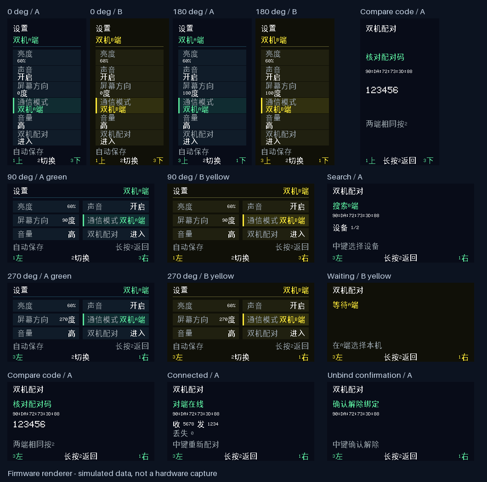

# 双机 CAN 转发 · 固件 1.24.4

同一份 ESP32-S3 固件支持四种模式：蓝牙（蓝色）、Wi-Fi（紫色）、双机 A 端（绿色）、双机 B 端（黄色）。A、B 各连接一条独立的 CAN 总线，通过 ESP-NOW 双向转发经典 CAN 帧；无需手机或路由器。A 负责搜索、B 等待选择，配对后的数据传输是双向的。

```text
CAN 总线 A ⇄ ESP32 A ⇄ ESP-NOW ⇄ ESP32 B ⇄ CAN 总线 B
```

## 屏幕配对

1. 两端烧录同一份固件。进入“设置 → 通信模式”，短按中键依次切换 `蓝牙 → WIFI → 双机A端 → 双机B端`，分别选择 A、B。
2. B 端进入新增的“**双机配对**”项，短按中键开始，显示“等待 A 端”。
3. A 端进入“**双机配对**”，短按中键搜索。两侧按键切换候选设备，中键选择；界面显示对端的 Wi-Fi MAC 地址及设备序号，最多列出四台。仅列出主动开放配对的 B 端。
4. 核对两端显示的**六位数字一致**，再分别短按中键确认。两端确认并保存成功后，界面显示“对端在线”。配对窗口从各自开始操作计时，共 60 秒；超时后可重新开始。
5. 长按中键返回设置，再长按返回 CAN 总览。绑定存入 NVS，重启或切回相同角色后自动恢复。配对完成后的管理页显示收、发、丢失计数。

管理页中，两侧按键可以选择“重新配对”或“解除绑定”。解除绑定需要再按一次中键确认；长按返回可取消。换绑失败时不会主动擦除旧记录；若只有一端保存成功，需要在两端重新完成配对。每台设备保存一份绑定，绑定包含当时的 A/B 角色；换到另一角色需重新配对。

进入双机模式会退出原来的手机数据会话、停止自动查询，关闭蓝牙广播及已有蓝牙连接，并停止连接路由器。退出双机模式后恢复对应的蓝牙/Wi-Fi 工作方式。原有 Wi-Fi 凭据保留。



## 电脑通过 USB 配对（固件 1.24.4）

两台分析仪均连接电脑原生 USB 数据口后，可在不操作屏幕的情况下配对：

```bash
desktop/.venv/bin/python scripts/dual-can-pair.py \
  --a /dev/serial/by-id/<A端USB身份> \
  --b /dev/serial/by-id/<B端USB身份> \
  --keep-dual --output /tmp/dual-can-pair.json
```

先关闭占用端口的客户端。工具核对 USB 序列号与本机 STA MAC，分别保存 CAN 和 A/B 模式，只选择另一条已连接 USB 的已知 MAC；读取双方独立派生的六位校验码并比较，相同才分别确认。成功必须同时满足双方绑定且在线。配对密钥不经过 USB 或日志；原有 ECDH、承诺、HKDF 和双端确认消息仍照常执行。电脑及两条物理 USB 连接成为此次本机确认的信任边界。

失败会尝试将两台恢复到 USB＋CAN，旧绑定不会主动擦除。默认成功后也恢复 USB＋CAN；只有指定 `--keep-dual` 才保持双机运行。配对开始、确认或保存响应缺失时不会自动重发，先查询状态再决定下一步。手动屏幕配对仍可用。

USB 独占管理命令 `0x1a` 不进入 BLE/TLS 命令分发，详见 [USB 管理协议](USB.md#物理-usb-管理固件-1244)。主机测试包含错误 MAC、错误校验码、旧 token、超时及单端确认拒绝；主机测试不代表实物配对已通过。

## CAN 转发规则

- 支持经典 CAN 的标准帧、扩展帧、数据帧及远程帧，保留 ID、DLC、EXT/RTR 和最多八字节有效载荷；不支持 CAN FD。
- 两端上电时沿用本项目默认 **1 Mbit/s CAN 波特率**，各自总线上的设备必须匹配。双机模式没有手机配置入口，也没有新增本机波特率设置。
- 只把本地 CAN 接收帧送到无线端；无线收到的帧进入现有 CAN 发送任务。发送结果和统计不再次无线转发，TWAI 没有启用自接收，避免软件自身回送。
- 两端应接两条独立 CAN 总线；不要把 A、B 再并接到同一条总线形成转发环路。无线链路转发的是帧，无法延伸 CAN 的逐位仲裁和 ACK 时序；每段 CAN 需要自己的接线、终端电阻和能应答的节点。
- 每批最多八帧，应用层 ACK 表示对端已接纳到 CAN 发送队列，**不等于对端 CAN 已发送成功**。CAN 发送结果继续由本机失败统计体现。
- 无线等待 ACK 后重试，同一批最多发送三次，重试间隔 25ms。接收端去重，不因 ACK 丢失而重复向 CAN 入队。
- 收、发队列各最多 128 帧；每端排队超过 100ms 的帧丢弃。断线和模式切换清理待处理队列；已经提交给 CAN 控制器的一帧仍可能完成。不会无限积压并在重连后补发旧指令。
- 200ms 心跳，约一秒未收到有效流量则转为离线。队列拥塞、过期和无线重试失败计入丢失计数；无线回调接收队列溢出也计数，因此该数字不是仅统计 CAN 帧。

无线带宽、干扰和 CAN 发送能力会限制吞吐；尚未实测满负载转发，不承诺两条 1 Mbit/s 总线同时满载时无损，也不适合作为硬实时逐位 CAN 总线延长线。

固件1.24.5提供默认关闭的构建候选`CAN_DUAL_RATE_6M`，通过`esp_now_set_peer_rate_config`在新增peer后请求802.11g/6Mbps；设置失败时撤销该peer，不静默当作已应用。此项改变双机无线PHY，既有加密、确认、CAN 100ms过期和重试规则不变，CAN总线仍为1Mbps。2026-11-06近距离台架中，默认速率多轮发生MAC失败及过期，6Mbps候选1000/5000逐帧及5000双端先发后等通过；距离、其他环境和UART吞吐未据此认定通过，因此保留为显式候选。构建示例：`bash firmware/idf.sh -D CAN_DUAL_RATE_6M=ON build`，恢复默认须明确传`OFF`，避免CMake缓存保留实验选项。

同版1.24.7默认→6Mbps→默认对照中，两次默认配置均在首组未完成，6Mbps中间轮通过1000条。进一步由STM32内部定频、独立CAN端逐序号核验，6Mbps双向各20/50/100帧每秒每档10秒通过；双向各200帧每秒时，两路各发2000帧，CAN1/CAN2实际收到1980/1995帧，并新增队列/待发过期计数。故逐帧矩阵通过不代表持续负载无损，尚不能给出长期稳定吞吐或距离保证。条件及恢复记录见[性能记录](PERFORMANCE.md)。

## 配对和链路实现

ESP-NOW 使用固定 2.4GHz 信道 6，无需 SSID/密码。配对使用独立的临时 P-256 ECDH 密钥，先固定双方公钥及随机数的 SHA-256 承诺，再公开并校验；完整握手内容绑定双方角色、MAC、会话随机数及公钥。HKDF-SHA256 派生配对密钥与六位校验码。只有双方的本机确认及认证确认消息均完成，才持久化新绑定。

这是项目实现的配对协议和交互，并非 ESP-IDF 自带的蓝牙式配对界面；尚未经过独立安全审计。每次配对使用新密钥，未使用公开固定密钥，也不会通过广播发送密钥。本机确认可通过屏幕按键或上述物理 USB 配对工具完成。

后续 CAN 数据及 ACK 使用应用层 AES-128-CCM（16 字节认证标签）保护。ESP-NOW peer 本身设为不使用 LMK 加密，避免把发现报文的可接收性误当作密钥已经协商完成。心跳使用 HMAC-SHA256 认证，A 端主导新的随机会话挑战；会话密钥、角色、包类型及序号共同隔离加密 nonce，重启/断线后拒收旧会话 CAN 数据，重复心跳不能刷新在线期限。

绑定记录位于 `can_dual/peer` NVS，屏幕设置升级为版本 5，兼容读取版本 1～4。与现有网络配置一样，目前没有启用 Flash Encryption，NVS 不能视作加密存储。

## 验证

- `bash scripts/test-host.sh` 增加实际配对/会话状态机测试，以及两份实际 `dual_link.c` 的模拟设备测试，使用 OpenSSL 3 真正执行 P-256、HMAC 和 AES-CCM；ESP32 正式固件使用 PSA Crypto。
- 测试覆盖双端确认、丢包重试、错误校验/认证标签、心跳重放、重启会话隔离、异步发送回调、双向 CAN、EXT/RTR、ACK 丢失去重、队列拥塞、过期清理、模式切换、计时回绕、取消解绑及持久化失败。
- 现有 CAN owner 测试覆盖无 App 连接时接收双机帧、发送缓冲区生命周期和完成计数；四方向渲染测试覆盖配对各状态及增量刷新。
- 主机测试需要 C 编译器和 OpenSSL 3 开发库。固件编译不依赖主机 OpenSSL。
- 2026-11-06，两台 ESP32-S3 与 STM32H723 的独立 CAN1/CAN2 完成物理 USB 自主配对及双向 50 组逐帧核对：标准/扩展、数据/远程、DLC 0～8 和 ID 边界，双方各发/收 25 帧、丢失计数零，STM32 CAN 错误零。测试结束自动恢复 USB＋CAN。台架源码及入口见 [STM32H723 台架](../fixtures/stm32-h723/README.md)。
- 以上实物结果仅代表该台架、该时段；无线距离、干扰、满负载吞吐和长期运行尚不能据此认定通过。
