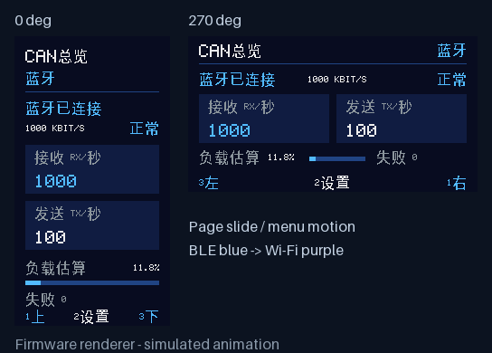
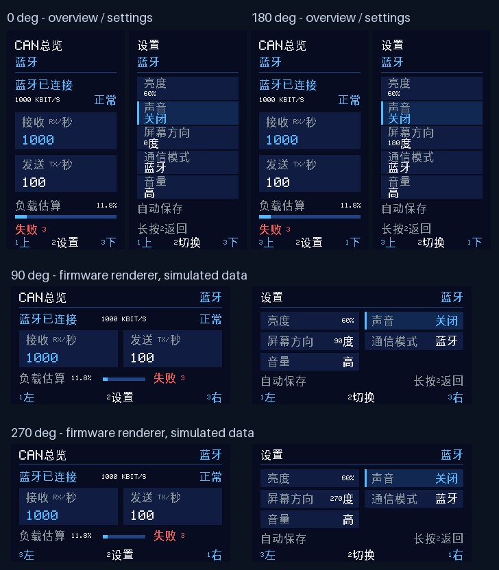
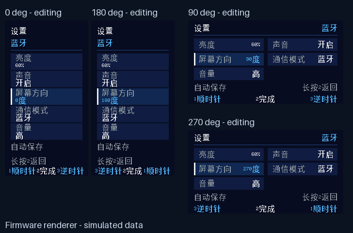
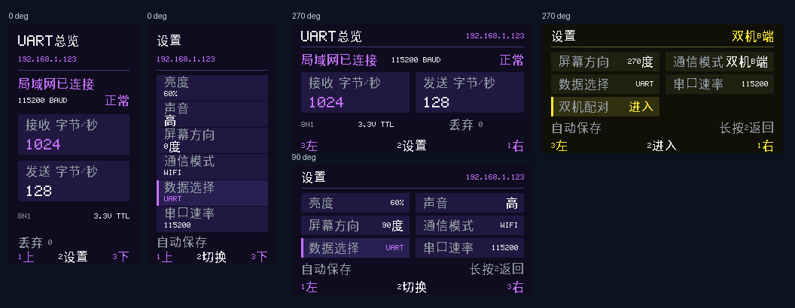

# 本机屏幕与按键 · 当前源码固件 1.23.1

适用 ESP32-S3 Mini + SN65HVD230 + 172×320 ST7789 SPI 屏。当前源码提供中文总览、设置两页及四个屏幕方向。已有 App 可继续连接，无需为本机屏幕更新 App。仅支持经典 CAN。

## 接线

| GPIO | 连接 |
| --- | --- |
| 1 / 2 / 7 | BT1 / BT2 / BT3，按键另一端接 GND |
| 3 | 绿色 0805 通信指示灯，经 1kΩ 接 LED 阳极；GPIO3 经 10kΩ 下拉到 GND |
| 4 / 5 | SN65HVD230 CTX / CRX |
| 6 | 背光 Q1 栅极，PWM 高电平点亮 |
| 8 | 屏幕 RESET，12pin 屏的 11 脚 |
| 9 | 屏幕 D/C，7 脚 |
| 10 | 屏幕 CS，8 脚 |
| 11 | 屏幕 SDA/MOSI，10 脚 |
| 12 | 屏幕 SCL/CLK，9 脚 |
| 13 | 有源蜂鸣器 Q2 栅极，高电平响 |

按此前电路连接屏幕 VDD、LEDA、LEDK 限流支路及各模块公共地。GPIO3 指示灯高电平点亮，LED 阴极接 GND；程序不开启内部下拉，三个按键开启内部上拉。GPIO6 使用 LEDC 低速通道 0 / 定时器 0，GPIO13 使用独立低速通道 1 / 定时器 1，均为 20kHz、10bit；蜂鸣器调节不改变背光通道。

## 通信指示灯

GPIO3 绿灯默认启用：无线未连接时熄灭；蓝牙、Wi-Fi 上位机或双机对端连接后常亮；本机实际收到 CAN 帧或完成 CAN 成功发送后，短暂熄灭约 50ms。持续收发时每次亮灯至少 150ms，最多约每秒 5 次闪烁。连接切换时清除旧活动，失败发送与无线心跳不触发闪烁。

Wi-Fi 必须完成上位机认证连接，只有连上路由器不会亮灯。指示灯独立于屏幕任务、方向和背光，关闭本机屏幕也可使用；旧 ESP32 目标不占用 GPIO3。详细行为与构建开关见 [通信指示灯](STATUS_LED.md)。现有 1.21.0 Release 不包含此新增功能。

## 页面与操作

屏幕使用中文菜单、状态和操作提示，保留 CAN、RX/TX 和速率单位。默认亮度 60%、声音高、方向 0°、数据 CAN；UART 默认 115200 baud / 8N1。本机屏幕不显示或缓存报文数据流；App 中的数据流功能仍可使用。

| 页面 | 显示内容 | 两侧按键短按 | 中间 BT2 短按 |
| --- | --- | --- | --- |
| CAN总览 | 蓝牙连接状态、波特率、CAN 状态、RX/TX 帧/秒、估算负载、累计发送失败 | 切换到设置 | 进入设置 |
| 设置 | 亮度、声音、屏幕方向、通信模式、数据选择；UART 时增加波特率 | 选择设置项；亮度编辑中减小 / 增大；方向编辑中 BT1 顺时针、BT3 逆时针 | 声音、通信模式、数据选择和串口波特率直接切换；亮度、方向进入 / 结束编辑 |

**声音**：选中后短按中间 BT2，按“关闭 → 低 → 中 → 高 → 关闭”循环，不进入编辑。低、中、高均表示声音开启；关闭时按键音和故障音都关闭。切到非关闭档位时播放约 80ms 试听音。原有独立“音量”菜单已合并，旧声音和音量设置升级后保留。

**数据选择**：选中后短按 BT2，在 CAN / UART 间切换，两者互斥。UART 时显示“串口波特率”，短按 BT2 在 9600、19200、38400、57600、115200、230400、460800、921600 间循环，固定 8N1。总览改为 UART 字节/秒、串口速率和丢弃字节数。App 自动切换串口页，接线和使用详见 [无线串口](UART.md)。


**长按中间 BT2 约 0.65 秒**：编辑中先退出编辑，其余情况回到总览。按键消抖 30ms，长按松手不会再触发一次短按。

**切换动画**：总览进入设置时向左滑动，返回时反向滑回，过渡约 240ms；选中框在菜单项之间用约 180ms 平滑移动；蓝牙蓝色与 Wi-Fi 紫色用约 280ms 渐变。页面滑动采用缓入缓出曲线，减小起步跳动；菜单和主题采用缓出曲线。连续按键会从当前插值位置转向最新目标；按键动作和通信模式立即生效。四个方向均支持这些效果，屏幕旋转仍在完整帧结束后切换方向。



以 270° 时屏幕上方三个按键从左到右为 BT3、BT2、BT1 的安装位置为基准，菜单选择随当前屏幕方向变化。四个方向编辑亮度时均由上方或左侧按键增加、下方或右侧按键减少；方向编辑固定使用 BT1 顺时针、BT3 逆时针：

| 屏幕方向 | 按键所在边 | 左 → 右或上 → 下的顺序 | 前一项 | 编辑 / 完成 / 切换 / 长按返回 | 后一项 | 亮度编辑 |
| --- | --- | --- | --- | --- | --- | --- |
| 0° | 左侧 | BT1、BT2、BT3 | BT1（上） | BT2（中） | BT3（下） | BT1 加、BT3 减 |
| 90° | 下方 | BT1、BT2、BT3 | BT1（左） | BT2（中） | BT3（右） | BT1 加、BT3 减 |
| 180° | 右侧 | BT3、BT2、BT1 | BT3（上） | BT2（中） | BT1（下） | BT3 加、BT1 减 |
| 270° | 上方 | BT3、BT2、BT1 | BT3（左） | BT2（中） | BT1（右） | BT3 加、BT1 减 |

底部提示按前、中、后顺序显示实际按键编号：例如 270° 设置页选中亮度或方向时为 `3左 / 2编辑 / 1右`，选中声音时为 `3左 / 2切换 / 1右`，编辑方向时为 `3逆时针 / 2完成 / 1顺时针`。竖屏菜单选择使用“上 / 下”。提示编号仍跟随屏幕上的按键位置，BT1 的顺时针、BT3 的逆时针功能始终固定，无需重新接线。

亮度为 10%～100%，每次调整 10 个百分点；0°/90° 编辑亮度时底部显示 `1加 / 2完成 / 3减`，180°/270° 显示 `3加 / 2完成 / 1减`。保留最低可见亮度，避免屏幕熄灭后难以恢复。设置停止变化 1.5 秒后写入 `local_panel/settings` NVS；重启恢复。保存失败时设置页显示“保存失败”并间隔 10 秒重试。蓝牙名称继续使用原有独立存储。

**设置屏幕方向**：总览页短按中间 BT2 进入设置 → 两侧按键选中“屏幕方向” → 短按 BT2 编辑 → **BT1 每次顺时针转 90°，BT3 每次逆时针转 90°**，在 **0°、90°、180°、270°** 间循环 → 短按 BT2 完成。长按 BT2 回到总览。角度表示相对于默认方向顺时针旋转；0°/180° 使用 172×320 竖屏布局，90°/270° 使用 320×172 横屏布局。

方向切换在当前完整帧 DMA 结束后执行，切换期间暂时关闭显示输出，待新方向首帧画完再显示。新设置保存为版本 6，增加 CAN/UART 选择与 UART 波特率。版本 1～5 的亮度、声音、方向、通信模式、音量按原含义迁移，新增数据类型默认 CAN、串口默认 115200。选择方向属于本机操作，不发送 CAN 指令；CAN 波特率仍由 App 设置。

蜂鸣器提供短按键音（约 25ms）及新通信失败/进入 BUS OFF 的提示音（约 100ms）。故障提示最多每 3 秒一次；纯仲裁让步不作为通信失败提示。声音关闭后所有提示均关闭。上电不鸣叫。

TMB09A03 在现有 3.3V、Q2 驱动电路上使用试验性 PWM 音量：低档约 60% 占空比，中档约 80%，高档持续高电平，与原有响声驱动一致。60% / 80% 是开关占空比，并非声压百分比，也不代表恒定供电电压。[器件规格书](https://pf.unikeyic.com/datasheet/f0/a1/4f32/f0a14f32d7a163e4778df24a9c6dcf7f.pdf)未提供 PWM 调音曲线，实际响度差异、音色和低档起振效果需要实物试听确认；若效果不理想可调整占空比或恢复高档。软件测试只验证驱动逻辑，不能验证声学效果。

## 数据与性能

- 屏幕采用 ESP-IDF 自带 ST7789 驱动，SPI2 20MHz。使用两个各 5504 字节的 DMA 条带缓冲区，合计 11008 字节，不要求 PSRAM。
- 独立低优先级任务按竖屏 16 行、横屏 8 行分段刷新，横屏末段为 4 行。动画每 20ms 请求下一帧；实际帧率由变化范围、SPI 传输和系统负载决定，20MHz 下传输一整屏像素本身约需 44ms。静止时每 100ms 检查状态，只发送有变化的条带。
- 绘制下一条带时可并行传输上一条带；每次提交新条带前等待旧 DMA 完成。两个缓冲区交替使用，一帧内固定动画位置、界面状态和数据快照，完成整帧后再处理下一帧；按键在条带之间持续采样，取消原有逐条带 10ms 等待。
- DMA 完成回调在唤醒绘制任务后显式请求 ISR 调度。ESP-IDF 6.0.2 的 SPI 面板驱动忽略回调返回值，仅返回 `true` 会使任务可能继续等待系统节拍。实机对比中，修正这处调度后，整屏帧平均耗时从 97.05ms 降到 50.57ms；测试条件见 [性能记录](PERFORMANCE.md)。
- 设置写入 NVS 会避开动画和提示音；停止操作 1.5 秒后的自动保存规则保持不变。选中框移动只刷新新旧位置涉及的条带，不在静止菜单上反复发送整屏。
- 中文采用 UTF-8 解析及固定 16×16 字形子集，116 个汉字的点阵数据共 3712 字节，字形索引另计；正常固件构建无需安装字体。来源、再生成方式及 OFL 1.1 许可见 [字库说明](../firmware/fonts/README.md)。
- CAN 收发任务只复制统计状态快照，不等待屏幕 SPI、按键或蜂鸣器；本机显示直接忽略 RX/TX 原始帧，不保留报文缓存。
- 统计来自 ESP32 的同一套 CAN 计数，不依赖 App 页面订阅和 BLE 上报。帧/秒速率按实际微秒统计窗口换算；累计失败与 App 保持一致，不含纯仲裁让步。
- “负载估算”来自设备端：成功 RX/TX 的经典帧基础位数及帧间隔，不含位填充、错误帧和失败尝试；不是精确物理总线占用率。
- 初始化或 SPI 传输失败会停止本机显示，CAN/BLE 继续工作；默认构建关闭日志。SPI 屏没有读回线路，软件初始化成功不能证明屏幕已连接或正常显示。

## 屏幕适配与构建

默认列偏移 34、行偏移 0、RGB565、颜色反转开启；这是同分辨率 ST7789 面板的常见配置，参考[微雪 1.47 英寸模块说明](https://www.waveshare.com/wiki/1.47inch_LCD_Module)和[172×320 官方示例偏移](https://docs.waveshare.net/ESP32-S3-Touch-LCD-1.47/Arduino/)。用户的 12pin 裸屏实际驱动参数仍需上板核对。

`bash firmware/idf.sh menuconfig` → `CAN analyzer local panel` 可开关本机面板、调整列偏移、RGB/BGR 顺序及颜色反转。旋转通过本机设置保存。如果颜色互换可调整 BGR；画面整体错位需核对面板资料中的地址偏移。旧 ESP32 目标默认不启用这些 S3 引脚。

驱动通过 `swap_xy` 与 `mirror` 组合选择方向，并同步调整可见区域偏移，参照 [ESP-IDF 6.0.2 LCD 控制接口](https://docs.espressif.com/projects/esp-idf/en/v6.0.2/esp32s3/api-reference/peripherals/lcd/index.html)。

```bash
bash firmware/idf.sh build
# 连接 ESP32-S3 后烧录，不擦除 NVS：
bash firmware/idf.sh -p /dev/ttyACM0 -b 115200 flash
```

主机测试覆盖两页导航、四方向物理按键位置和亮度增减映射、中键短按/长按、声音四档直接切换、CAN/UART 互斥与波特率切换、BT1/BT3 固定旋转方向、版本 1～5 设置迁移与保存、独立 PWM 通道与静音/持续高电平/PWM 恢复/驱动失败处理、UTF-8 非法/截断输入、字形覆盖、可见区域映射及末段 DMA 缓冲边界，并继续运行 CAN 查询、收发、IMU 订阅回归测试。页面预览由实际 C 绘制代码生成，使用模拟数值；实体屏幕的方向、可读性及按键手感仍需人工确认。

动画测试另外覆盖中途反向、连续输入、计时回绕、旋转时重建坐标、配对弹层和蓝紫主题渐变；将局部刷新应用到上一帧后，与整屏重新绘制逐像素比对，检查残影和漏刷。`python3 scripts/render-panel-animation.py` 重新生成上面的动画及分帧预览；预览时序不代表设备实测帧率。





旧版本的独立音量菜单预览已由合并声音设置替代。

通信模式通过中间 BT2 直接切换：蓝牙为蓝色，Wi-Fi 为紫色。配网与 App 操作见 [局域网说明](WIFI.md)。

## 双机模式

通信模式现在按“蓝牙 → WIFI → 双机A端 → 双机B端”循环。A 端为绿色、B 端为黄色；两种双机模式均增加“双机配对”，完全通过屏幕和按键完成配对、确认和解除绑定。CAN 时共六项，UART 时共七项；每屏最多六项，选中最后一项时自动滚动。横屏两列、竖屏单列；声音使用上述四档切换。完整操作和转发边界见 [双机 CAN 转发](DUAL_CAN.md)。

## 1.23.0 UART 面板预览

下图由当前 C 绘制代码生成，用于检查布局；数值为测试输入。



1.23.1：竖屏设置超过五项时（例如 UART），底部优先显示“长按2返回”；横屏仍同时显示“自动保存”和返回提示。保存失败时继续显示错误提示。

## USB直连

固件 1.24.0 通信模式增加 USB直连，CAN 与 UART 数据选择均可使用，屏幕红色主题。设置由五种通信模式循环，USB 不显示双机配对菜单。配置记录升级为 v7，保留 v1–v6 旧配置。详见 [USB 接线与使用](USB.md)。
