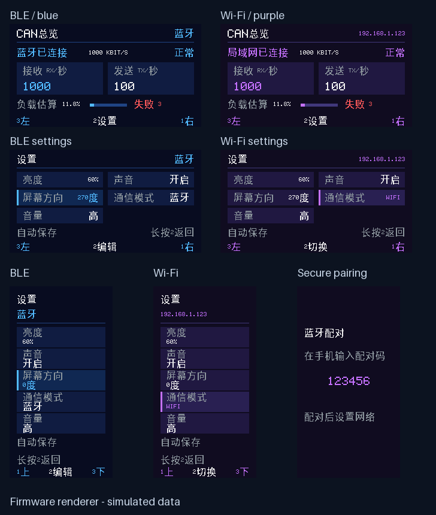

# 蓝牙 / 局域网通信 · 1.20.0

保留原有蓝牙 CAN 通信，在此基础上增加 Wi-Fi 局域网通道。设备同一时间只有一种 CAN 数据通道。蓝牙配网服务在两种模式下都可使用，Wi-Fi 故障时可用实体按键切回蓝牙。

## 第一次使用

1. 安装 1.20.0 App，使用蓝牙连接 ESP32，打开“设备设置 → Wi-Fi 配置”。
2. 点击“扫描 Wi-Fi”。首次会弹出 Android 系统配对界面，把 ESP32 屏幕显示的六位数字输入手机；后续同一手机使用已保存的配对记录。
3. 选择设备附近的 **2.4 GHz Wi-Fi**，或手动输入网络名称和密码，点击“连接并保存到 ESP32”。开放网络密码留空。设备取得 IP 后才保存；密码错误、找不到网络或超时不会覆盖上一次成功配置。
4. 在 ESP32 设置页选中“通信模式”，**短按中间 BT2** 切到 `WIFI`。屏幕整体变为紫色，总览显示 IP 和网络状态。蓝牙模式为蓝色。
5. 手机连接相同局域网，在 App 对应通道把“连接方式”改为“局域网 Wi-Fi”，点击“连接设备”。可发现已配对设备；路由器阻止广播时，手动输入屏幕 IP。

切回蓝牙：设备“通信模式”切为“蓝牙”，App 连接方式也选择“蓝牙”，重新连接。设备按键不会修改 App 的选择，App 也不会远程切换设备模式。切换时会停止原连接的查询；新连接后由用户重新开启。设备模式停止修改 1.5 秒后保存，重启沿用；旧固件设置迁移后默认蓝牙。

Wi-Fi 模式会自动连接已保存网络、掉线重试。蓝牙模式配网成功后保留网络约一分钟供 App 读取 IP，然后关闭 Wi-Fi 无线连接。蓝牙已配对的手机还可从“设备设置”清除设备保存的 Wi-Fi。App 卸载或更换手机后需重新通过蓝牙取得设备连接信息。

首页“连接”按各通道保存的通信方式重连；Wi-Fi 首先使用保存的 IP。若路由器重新分配地址，请在该通道搜索或输入新 IP。每个通道独立保存选择，同一设备不允许被多个通道重复占用。

Android 1.21.1 起为同网段设备的 TCP socket 选择直接连接的物理 Wi-Fi，避免默认路径上的 VPN 影响局域网握手；仅匹配实际 Wi-Fi IPv4 地址的有效子网前缀，不将默认路由当作同网段。不修改手机 VPN 或系统默认网络，证书固定校验和令牌认证仍照常进行。断开时先终止底层 socket，再在工作线程清理 TLS，避免 Android 在主线程发送 TLS 关闭通知时抛出异常。

## 通信与存储

- Android 使用现有 NimBLE 服务新增的 `c0de0004-1212-efde-1523-785feabcd123` GATT 特征进行配置。读写均要求 LE Secure Connections、加密及 MITM 认证。屏幕显示随机六位配对码；SSID、密码、证书指纹和访问令牌不走明文蓝牙。
- 局域网使用 TCP 32323 上的 TLS。设备生成独立 P-256 证书和 32 字节随机令牌；App 通过已认证的蓝牙取得 SHA-256 证书指纹并固定校验，同时提交令牌认证。不依赖互联网或公共 CA，不将网络密码存入网页 localStorage、配置导出文件或日志。
- ESP32 将成功的 Wi-Fi 配置及设备密钥保存在 NVS。Android 在应用私有配置中保存指纹、令牌、设备身份及 IP。当前没有启用 ESP32 Flash Encryption，不能将 NVS 描述为加密存储。Android 禁用系统应用备份；通道配置导入/导出不包含配网凭据。
- 仅一条经过认证的局域网连接拥有 CAN 通道；蓝牙仍可配网。连接关闭、网络变化及实体模式切换会清理查询租约与待发送数据。每 3 秒发送心跳，12 秒无输入断开；缓冲队列有上限。
- UDP 32323 广播发现仅返回设备 ID 和端口，不返回 SSID、密码或令牌。App 仅列出已配对 ID，最终连接仍通过证书验证。访客网络/AP 隔离会阻断设备互访。

发现请求 `CAN_SCOPE_DISCOVER_1` 为 20 字节。固件 1.24.3 的长度修复同时接受完整请求和旧版误接受的 19 字节 `CAN_SCOPE_DISCOVER_`；Android 1.21.1 同时发送两种请求以兼容旧镜像。缓存 IP 列表项不是发现响应，搜索恢复检查必须收到新的匹配设备 ID 回应。

## 配网协议

每次写入 20 字节，未用字段为零。读为 UTF-8 JSON，最长 512 字节。

| 操作码 | 内容 |
| --- | --- |
| 1 | 读取状态：state、error、busy、mode、ip、SSID 的十六进制 UTF-8、id、fp、token、port |
| 2 | 异步扫描，最多 12 个网络；结束后用操作 7 分页读取 |
| 3 | 开始事务：byte1 事务号、byte2 SSID 字节数、byte3 密码字节数 |
| 4 | 连续分片：byte1 事务号、byte2 偏移、byte3 长度 1–16、byte4 起为 SSID+密码字节 |
| 5 | 提交：byte1 事务号；连接成功才持久化 |
| 6 | 清除保存的 Wi-Fi 配置 |
| 7 | 扫描分页：byte2 偏移，每页最多三个网络，返回 scan、total、offset |

SSID 1–32 字节，密码为 0、8–63 个可打印 ASCII 字符或 64 个十六进制字符。分片必须连续、不重放，完整事务需在 10 秒内提交；失败/断开会清理未提交缓冲。配网连接超时 20 秒，期间 App 持续读取 busy。凭据只在 Android 原生层保存，`fp` 和 `token` 在状态转发 WebView 之前移除。

TLS 建立后，客户端发送 ASCII `CAN1` 加 32 字节令牌，设备回复 `OK01`。随后双向传输原有 20 字节 CAN Scope 包，必须按固定长度重组 TCP 分片。设备事件 18 表示命令写入结果：byte2 为状态，byte4–7 回显请求 byte16–19；原有具体命令 ACK 仍有效。客户端命令 `01 7F` 加 18 个零为心跳，设备原样回复，App 不把心跳加入 CAN 记录。蓝牙事件 17 的 byte2 表示设备模式（0 蓝牙 / 1 Wi-Fi），让 App 明确提示当前蓝牙只可配网。

## 构建与升级

首次升级须烧录新的分区表和程序（`flash`），不能仅用旧的 1 MB 分区做 `app-flash`。`firmware/partitions.csv` 将 factory 增至 2 MB；NVS 仍位于 0x9000、大小 0x6000，程序仍从 0x10000 开始，不擦除已有设置。使用旧缓存 sdkconfig 时需在 menuconfig 中启用自定义分区，以及 sdkconfig.defaults 中的 NimBLE 安全、持久配对、TLS 服务端和 X.509 证书生成选项。

```bash
bash firmware/idf.sh build
bash firmware/idf.sh -p /dev/ttyACM0 -b 460800 flash
bash android/build.sh
bash scripts/test-host.sh
python tests/test_network_ui.py
```

主机测试覆盖凭据边界/分片/重放/超时、TLS 证书拒绝与真实本地 TLS 握手、TCP 拆包合包/写入/断开、UI 配网流程及按键设置迁移。预览是实际绘制代码的模拟数据，不代表实体屏幕照片；实际路由器配网与手机系统配对仍需硬件联调。



## 与双机模式的关系

固件 1.21.0 新增独立的“双机A端 / 双机B端”模式。双机模式会断开手机和路由器，使用屏幕按键进行配对并双向转发两条 CAN 总线；返回蓝牙/Wi-Fi 后恢复原有工作方式，已保存的 Wi-Fi 配置保留。见 [双机 CAN 转发](DUAL_CAN.md)。
